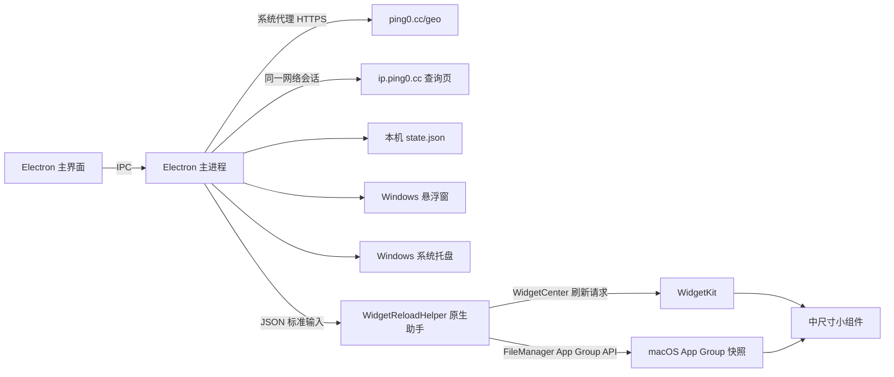

# Ping Observer 2.0.0 源码与使用说明

## 1. 项目简介

Ping Observer 是一个本机桌面网络信息观察工具。它通过 `ping0.cc` 查询当前网络出口 IP 的信息，并把最常用的三项内容放在主界面和 macOS 中尺寸小组件中：

- **IP 位置**：由 `ping0.cc` 返回的出口 IP 归属位置。
- **风控参考值**：查询页面提供的分数和文字说明。
- **估算共享人数**：查询页面提供的区间估算。

应用不自行推算、补齐或伪造网站没有提供的字段。网站暂时没有返回某一项、页面需要安全验证，或网页结构发生变化时，对应信息可能为空或显示等待状态。

当前版本号为 **2.0.0**。桌面主程序基于 Electron；macOS 使用 SwiftUI 和 WidgetKit 小组件，Windows 使用 Electron 悬浮窗和系统托盘提供快速查看入口。项目配置了 Windows x64 NSIS 安装程序目标。

## 2. 功能一览

### 主界面

- 展示 IP 位置、风控参考值和估算共享人数。
- 支持手动点击“立即检测”。
- 支持暂停或开启自动更新，并选择 5、10、15、30 分钟、1 小时或 2 小时的间隔。
- 自动更新设置和最近一次检测信息保存在本机。
- 顶部区域可拖动窗口；鼠标移入时会显示淡色辅助线。间隔选择器和操作按钮仍可正常点击。
- 检测状态会说明数据是否已从 `ping0.cc` 查询页面读取，或是否遇到了安全验证、网络错误等情况。

### macOS 桌面小组件

- 提供**中尺寸** WidgetKit 小组件，显示上述三项信息和最近更新时间。
- 主程序保存新数据后，会通过 App Group 共享数据，并请求 WidgetKit 刷新小组件时间线。
- 小组件只读取本机共享快照，不会自行向另一个数据服务查询。
- 首次检测前显示等待状态；主程序退出后，小组件仍可显示最近一次快照，但不会自行执行主程序的检测任务。

WidgetKit 会根据系统调度和刷新预算决定实际绘制时间。因此，即使应用请求刷新，画面也可能有短暂延迟；这属于系统调度行为。

### Windows 悬浮窗与系统托盘

- 悬浮窗显示与主界面相同的 IP 位置、风控参考值、估算共享人数和更新时间，不会单独发起网络查询。
- 悬浮窗默认置顶、可拖动并记住位置；关闭悬浮窗会隐藏它，位置和显示状态保存在本机状态文件中。
- 悬浮窗可直接触发检测、打开主窗口或隐藏自身。主窗口工具栏也提供悬浮窗显示/隐藏入口。
- 关闭主窗口会将应用留在 Windows 通知区域（系统托盘）；从托盘可打开主窗口、显示/隐藏悬浮窗、切换置顶、暂停/开启自动更新、立即检测或退出应用。
- Windows 使用单实例运行；再次启动会唤起已有主窗口。
- 关闭主窗口后应用仍在运行，自动更新会继续；从托盘选择“退出 Ping Observer”后检测停止。

## 3. 界面与数据来源

### 网络出口与代理

主程序使用 Electron 网络会话的系统代理设置访问 `https://ping0.cc/geo`，再以返回的 IP 打开 `https://ip.ping0.cc/ip/<IP>` 查询详情。查询使用操作系统配置的代理，目标是让它与同样使用系统代理的浏览器看到同一个出口 IP。

如果浏览器的 VPN 仅通过浏览器扩展、浏览器专用代理、独立配置文件或按域名规则运行，而操作系统没有配置相同代理，浏览器和本软件仍可能看到不同的出口 IP。核对时请比较两边查询到的 IP 地址，并确认浏览器和系统应用走的是同一代理节点。

### 页面读取

应用读取 `ping0.cc` 查询页的可见文本，并从中识别 IP 类型、风控值、说明和共享人数区间。当前主界面和小组件重点展示位置、风控值与共享人数；IP 类型等字段不会作为重点卡片显示。

如果网站要求 CAPTCHA、Turnstile 或其他人工安全验证，应用会显示查询页供用户完成验证。应用不会尝试绕过安全验证。网站页面改版、字段文案变化或网络拦截也可能导致解析不到某些字段。

## 4. 数据流与架构



### 两类本机数据

1. **应用状态文件**：macOS 为 `~/Desktop/IP/ping/data/state.json`；Windows 安装版优先放在安装目录的 `data/state.json`，安装目录不可写时回退到 Windows 用户数据目录。保存自动更新设置、最近检测结果和本机历史数据。
2. **小组件快照**：macOS App Group 容器中的 `ping-observer-widget.json`。由 `WidgetReloadHelper` 使用 `FileManager.containerURL(forSecurityApplicationGroupIdentifier:)` 写入，避免依赖手工拼接共享目录路径。写入后助手调用 `WidgetCenter` 请求刷新对应时间线。

应用组标识由签名团队 ID 生成：

```text
<TEAM_ID>.group.cc.ping0.observer
```

主程序、WidgetKit 扩展和原生刷新助手必须使用一致的 Team ID 与 App Group 标识，否则小组件无法读取主程序写入的数据。

## 5. 源码目录结构

```text
软件源码/
├── README.md
├── package.json
├── package-lock.json
├── src/
│   ├── main.cjs          # 窗口、网络会话、查询、解析、持久化和 IPC
│   ├── preload.cjs       # 安全地向界面公开 IPC 接口
│   ├── renderer.js       # 页面渲染、按钮行为和窗口拖动交互
│   ├── index.html        # 主界面结构与样式
│   ├── floating-renderer.js # Windows 悬浮窗渲染和操作
│   └── floating.html     # Windows 悬浮窗结构与样式
├── widget/
│   ├── PingObserverWidget.xcodeproj/
│   ├── PingObserverWidget/
│   │   ├── PingObserverWidget.swift
│   │   ├── Info.plist
│   │   └── PingObserverWidget.entitlements
│   ├── WidgetReloadHelper.swift
│   └── WidgetReloadHelper-Info.plist
└── build/
    ├── build-widget.cjs  # 编译、签名并打包 WidgetKit 扩展和刷新助手
    ├── make-dmg.cjs      # 生成 macOS DMG
    ├── entitlements.mac.plist
    └── icon.*            # 应用图标资源
```

### 主要文件说明

| 文件 | 用途 |
| --- | --- |
| `src/main.cjs` | 创建 Electron 窗口与 Windows 系统托盘；配置系统代理会话；读取 IP 位置和详情；解析网站字段；保存状态；调用小组件同步助手。 |
| `src/preload.cjs` | 在隔离上下文中提供受限的状态、刷新、设置和窗口拖动接口。 |
| `src/renderer.js` | 更新界面、控制自动刷新选项、处理手动检测和拖动标题区。 |
| `src/index.html` | 主界面 HTML 和 CSS，包括高一些的顶部拖动区及悬停辅助线。 |
| `src/floating.html` / `src/floating-renderer.js` | Windows 快速查看悬浮窗；读取主进程状态并提供刷新、打开主窗口和隐藏操作。 |
| `widget/PingObserverWidget/PingObserverWidget.swift` | WidgetKit 时间线、共享快照读取和中尺寸小组件 UI。 |
| `widget/WidgetReloadHelper.swift` | 通过标准输入接收快照，使用 App Group API 写入共享容器，并请求 WidgetKit 刷新。 |
| `build/build-widget.cjs` | 读取 Team ID，生成 App Group 标识，调用 Xcode 编译原生组件，再运行 Electron 打包和签名。 |
| `package.json` | Electron 依赖、运行命令、打包目标、图标和安装程序配置。 |

## 6. 运行环境

### 运行主程序

- Node.js **22.12 或更新版本**。
- npm（随 Node.js 一起安装）。
- Windows 源码运行时会在 Electron 用户数据目录下保存状态；Windows 安装版优先使用安装目录中的 `data` 文件夹。

### 编译 macOS 安装包和小组件

- 完整版 Xcode，不能只安装 Command Line Tools。
- Xcode 中已登录 Apple 账号，并能取得 Apple Development 签名身份。
- Team ID 和签名证书需要匹配。
- 小组件部署目标为 macOS 14 或更新版本。
- 当前 macOS 打包目标为 Apple Silicon arm64。

本人本机开发和使用可使用 Xcode 的 Personal Team；不需要为本地运行加入付费 Apple Developer Program，也不需要公证。但个人开发签名不等同于面向公众发行的 Developer ID 签名。

## 7. 从源码运行

进入本目录后安装依赖并启动 Electron：

```sh
npm ci
npm start
```

也可以使用 `npm install` 安装依赖。运行时应用窗口会加载本地 `src/index.html`，网络检测则由 Electron 主进程完成。

## 8. 编译 macOS 安装包

### 8.1 配置 Team ID

项目会优先读取环境变量 `PING0_TEAM_ID`；未设置时会尝试使用 Xcode 项目里配置的 Team ID。复制到另一台机器时，应使用新机器自己的 Team ID：

```sh
export PING0_TEAM_ID="你的10位TeamID"
```

也可以指定本机已经存在的 Apple Development 证书名称：

```sh
export CSC_NAME="Apple Development: 你的姓名或账号 (你的10位TeamID)"
```

如果没有指定 `CSC_NAME`，构建脚本会尝试从钥匙串中选择有效的 Apple Development 身份。

### 8.2 构建

```sh
npm ci
npm run dist:mac
```

流程会编译 WidgetKit 扩展和原生刷新助手，生成共享 App Group 配置，调用 `electron-builder` 打包 arm64 应用，再签名并生成 DMG。默认输出为：

```text
dist/Ping-Observer-2.0.0-macOS-arm64.dmg
```

安装时打开 DMG，将 **Ping Observer.app** 拖到“应用程序”文件夹。若是自己编译的个人签名版本，macOS 可能显示首次打开提示；请确认应用来自本机源码后再按系统提示打开。

### 8.3 小组件签名注意事项

- WidgetKit 扩展有自己的 App Group entitlement 和 App Sandbox entitlement。
- 主程序与助手使用相同 Team ID 和 App Group；助手的 Bundle Identifier 与主程序保持一致，以便通过 `WidgetCenter` 刷新此应用的小组件。
- 扩展需嵌入 `Ping Observer.app/Contents/PlugIns/`。
- 刷新助手需嵌入 `Ping Observer.app/Contents/Helpers/`。
- 修改应用包里的任何文件后，代码签名都需要重新生成；不要在签名后直接修改应用内容。

## 9. Windows 构建说明

`package.json` 配置了 Windows x64 NSIS 安装程序目标：

```sh
npm run dist:win
```

安装程序名称为 `Ping-Observer-2.0.0-Windows-x64-Setup.exe`。Windows 端使用 Electron 悬浮窗和系统托盘，不使用 macOS WidgetKit。打包配置会将托盘图标复制到应用资源目录。生成的安装包位于 `dist/` 目录；该构建产物不会作为源码文件提交到仓库。

## 10. 本机数据与网络

- macOS 设置和检测状态保存在 `~/Desktop/IP/ping/data/state.json`。
- Windows 安装版的设置和检测状态优先保存在应用安装目录的 `data/state.json`；若该目录不可写，则保存在 Electron 用户数据目录的 `data/state.json`。源码运行时使用 Windows 用户数据目录。
- Windows 悬浮窗是否显示、置顶状态和上次位置也保存在同一状态文件中；关闭主窗口只隐藏到托盘，不会停止检测。
- 首次启动新版 Windows 程序时，会把旧版 `Desktop/IP/ping/data` 中的设置、历史和应用配置迁移到新位置，并在迁移成功后清理旧目录。
- App Group 快照保存在本机用户目录的 Group Containers 中，不会上传到 Ping Observer 自有服务器。
- 为查询，应用会向 `ping0.cc` 发起网络请求；查询目标是当前出口 IP 及其对应详情页。
- 代理使用系统配置。只在浏览器中运行的 VPN 扩展不一定会代理 Electron 应用。
- `ping0.cc` 返回的风险分数和共享人数是网站的参考/估算数据，并非本软件独立测量结果。
- 停止自动更新不会清除最后一次结果；完全退出应用后定时检测停止。重新启动后应用会恢复保存的设置并按当前配置继续。

## 11. 常见问题排查

### 主界面有数据，小组件仍显示“等待检测”

确认主程序已完成一次检测，底部状态不是连接错误或安全验证提示。主程序保存结果时会调用刷新助手；助手通过 App Group API 写入数据并请求 WidgetKit 刷新。系统可能合并或延后时间线刷新。如果连续一段时间仍未更新，可先退出并重新打开 Ping Observer；再不行时，从桌面移除小组件后重新添加，以建立新的时间线。

### 浏览器和应用显示不同 IP

确认浏览器和操作系统走同一个 VPN 节点/代理。若 VPN 只通过浏览器扩展接管浏览器流量，本应用使用的系统代理可能仍是直连或另一节点。可在浏览器与软件中分别查看实际 IP，再检查系统代理和 VPN 设置。

### Windows 关闭主窗口后应用仍在运行

这是托盘驻留行为。可从通知区域的 Ping Observer 图标重新打开主窗口或悬浮窗；要停止自动检测并退出进程，请在托盘菜单选择“退出 Ping Observer”。

### 风控值或共享人数没有显示

这两项来自 `ping0.cc` 查询页。网站可能未提供数据、要求安全验证，或已修改页面结构。完成页面上的人工验证后，可回到应用点击“立即检测”。如果网站没有给出某个字段，应用会保留为空，不会用其他来源猜测。

### 小组件不出现在“编辑小组件”列表

确认当前运行的是包含 WidgetKit 扩展的安装包，并且 macOS 版本为 14 或更新。扩展应位于应用包的 `Contents/PlugIns/PingObserverWidget.appex`。安装或替换应用后可退出并重新打开应用，再重新进入桌面“编辑小组件”。

### macOS 提示应用无法打开或意外退出

使用完整安装包替换旧版本，不要只复制单个可执行文件或手工覆盖已签名应用中的某个文件。若从源码重新构建，检查 Xcode 是否登录、签名身份是否有效、Team ID 是否正确，并确认 `build/entitlements.mac.plist` 中的 JIT 和 App Group 权限仍被应用。

### macOS 构建找不到 Xcode 或签名身份

检查 Xcode 完整安装路径和 `DEVELOPER_DIR`，并在 Xcode 账号设置中确认 Apple Development 身份可用。检查 `PING0_TEAM_ID` 是否为 10 位 Team ID。首次构建时 Xcode 可能需要联网创建或更新本机开发配置。

## 12. 已知边界

- 数据准确性和字段是否存在取决于 `ping0.cc`。
- 网站安全验证需要用户手动处理。
- WidgetKit 刷新时间由 macOS 决定，主动请求刷新也不保证立刻重绘。
- 主界面的自动检测需要应用进程保持运行；关闭窗口和退出应用在 macOS 上不完全相同。
- Windows x64 安装程序已生成，但尚未对安装后的程序完成完整运行验证；当前构建没有代码签名。
- 当前 macOS arm64 安装包及 WidgetKit 流程保持独立；Windows 不包含 macOS 小组件。

## 13. 依赖与版本

| 项目 | 版本 / 说明 |
| --- | --- |
| Ping Observer | 2.0.0 |
| Electron | `package.json` 中声明 `^45.0.0` |
| electron-builder | `package.json` 中声明 `^26.0.0` |
| Node.js | `>=22.12.0` |
| WidgetKit 最低目标 | macOS 14.0 |
| 当前 macOS 安装包架构 | Apple Silicon arm64 |

---

本源码目录用于阅读、修改和重新构建。构建产物、Node 依赖目录、本机数据和 Xcode 中间文件未复制到此目录。
